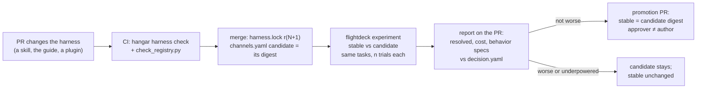

# Team harness (example)

A **team harness** is everything that shapes how your team's coding agent behaves, kept in git and pinned by digest:
the instructions it reads, its skills, its hooks, its plugins and which MCP servers it may call. This repository is a
complete, copyable example built around a typical stack: **OpenSpec**, **GitHub** (PRs and Projects), **Jira**,
**Splunk** and **GKE**. It is used with [hangar](https://github.com/Sean-Koval/hangar) (runs agents from it),
[flightdeck](https://github.com/Sean-Koval/flightdeck) (judges changes to it) and
[ai-dlc](https://github.com/Sean-Koval/ai-dlc) (authors the workflow plugin it pins).

> This is the standalone repository of the example that started in
> [agent-factory](https://github.com/Sean-Koval/agent-factory) (`examples/team-harness/`, now a pointer here). Its git
> history is part of the registry: hangar resolves channels that aren't the current lock (such as `stable` = r1) from
> older commits of `harnesses/team-default/harness.lock`, so keep the history when you fork or copy it.

Nothing here belongs to a real organisation: endpoints are public vendor URLs or `example.com`, and credentials
appear by name only.

## What it looks like

```text
harnesses/team-default/
  CLAUDE.md                          the team's instructions (AGENTS.md is the same bytes, for Codex)
  skills/
    openspec-change/SKILL.md         propose, validate, implement and archive one OpenSpec change
    github-pr/SKILL.md               branch, PR body, checks, and the Projects Status field
    jira-ticket/SKILL.md             pick up "Ready for agent", comment, link, transition
    splunk-logs/SKILL.md             bounded, read-only log searches through the splunk MCP server
    gke-diagnose/SKILL.md            read-only cluster diagnosis through the gke MCP server
  native/claude-code/
    settings.json                    hooks + deny rules, written to ~/.claude/settings.json
    hooks/guard_readonly.py          PreToolUse: blocks mutating kubectl/helm/gcloud and credential dumps
  plugins/team-harness/              a Claude Code directory marketplace (hangar#221 layout)
    .claude-plugin/marketplace.json  lists exactly the lock's plugins of this marketplace
    ai-dlc-workflow/                 the ai-dlc workflow plugin, pinned as one component
  harness.lock                       pins all of the above, plus the CLI version, model and MCP bindings
  releases/rN/                       release copies: each promoted lock and its files (scripts/promote.py)
  env.stable.yaml                    environment team-default: stable's release copy (generated)
  env.candidate.yaml                 environment team-default-candidate: the current lock (generated)
channels.yaml                        {stable: sha256:…, candidate: sha256:…} for each harness
```

A second harness, `work-default`, and the environments around it are for a company's four-repo services (see
[Work roles](#work-roles-the-four-repo-convention)):

```text
harnesses/work-default/
  CLAUDE.md, AGENTS.md               how the agent works across a service's infra, database, code and deploy repos
  skills/
    change-set/SKILL.md              plan across /workspace/<role>, keep each repo safe on its own, say what depends on what
    jira-ticket/ … work-start/       the shared work-system layer, rendered from shared/work-system/profiles/work-default.yaml:
                                     jira-ticket, work-start, decision-ticket, work-docs, and these two
    github-pr/SKILL.md               the per-repo PR description; hangar opens, links and lands the PRs; never merge
    release-approvals/SKILL.md       runs the gates the org overlay declares: one approval ticket per gate, drafted review request
  native/claude-code/
    settings.json                    hooks + deny rules (gh pr merge is denied)
    hooks/guard_work.py              PreToolUse: no terraform apply or real backends, no shared databases, no
                                     cluster changes, no edits under /workspace/deploy
    hooks/guard_work_system.py       PreToolUse: the shared work-system hook (see below); refuses every merge here
  harness.lock, env.stable.yaml      as for team-default; `stable` and `candidate` are both r3 (11 components)
environments/
  roles/{infra,code,database,deploy}.yaml   role-infra, role-code, role-database, role-deploy: work-default + each role's tools
  work-multirepo.yaml                one image with the infra, code and database roles' tools, for change sets
changesets/example-service.yaml      an example change-set profile over those environments
```

The lock is hangar's `hangar.harness-lock/v1`. One component per file or directory, and a binding layer that holds
names, never values:

```yaml
schema: hangar.harness-lock/v1
name: team-default
revision: 5
runtime: {harness: claude-code, version: 2.1.296}
model: {id: claude-opus-5-5, policy: balanced}
components:
- {id: guide:CLAUDE.md, digest: sha256:2ac8…, path: CLAUDE.md}
- {id: skill:github-pr, digest: sha256:4991…, tree: sha256:7205…, path: skills/github-pr}
# … four more skills, then the plugin and the native files
- {id: plugin:ai-dlc-workflow@team-harness, digest: sha256:…, tree: sha256:…, path: plugins/team-harness/ai-dlc-workflow, enabled: true}
binding:
  mcp:
  - {name: github, transport: http, endpoint: "https://api.githubcopilot.com/mcp/", header_names: [Authorization]}
  - {name: gke, transport: stdio, command: kubernetes-mcp-server, args: [--read-only], env_names: [KUBECONFIG]}
  - {name: jira, transport: http, endpoint: "https://mcp.atlassian.com/v1/mcp", header_names: [Authorization]}
  - {name: splunk, transport: http, endpoint: "https://splunk.example.com:8089/services/mcp", header_names: [Authorization]}
  hooks:
  - {event: SessionStart, source: environment:.claude/settings.json, digest: sha256:6165…}
  - {event: PreToolUse, source: environment:.claude/settings.json, digest: sha256:6165…}
  permissions: {approvals: deny-risky}
plugins: {autoUpdate: false}
remote: []
```

Its identity is one digest, `harness_digest`. A turn hangar runs from this harness reports the same digest in its
manifest; if the sandbox had anything else, the difference is recorded as drift.

```console
$ hangar harness check harnesses/team-default
ok: team-default r5, 9 component(s), harness_digest sha256:…
```

## The work system: every surface, same rules

`suite-default` (Sean's own projects) and `work-default` (a company's services) carry one shared layer that makes
agents follow the engineering work system: Jira for tickets, decisions and the roadmap; Confluence for engineering
knowledge; the repository for what agents obey; GitHub as the evidence. The model it implements, with every status,
label and field, is in [Sean-Koval/cabinet `config/work-system/`](https://github.com/Sean-Koval/cabinet/tree/main/config/work-system).

The rules are enforced in layers, each catching what the one before can't:

| Layer | Where | Holds for | What it does |
| --- | --- | --- | --- |
| Skills | `shared/work-system/skills/` | every session with the harness | `jira-ticket` (read first, comment, never transition), `work-start` (find or file the ticket, key the branch), `decision-ticket` (a question becomes a Decision that blocks the work; a ruling is drafted for confirmation), `work-docs` (which doc goes where, the `Docs:` line), `github-pr` (who opens it, the contract, the merge rule), `extract-records`, the knowledge skills `knowledge-context` (the scope's indexes and binding records before a ticket, under a token ceiling), `query-knowledge` and `whats-next` (through ai-dlc's knowledge role only), and for work-default `release-approvals` |
| Session hook | `shared/work-system/hooks/guard_work_system.py` | Claude Code with the harness (hangar, local, cloud) | refuses a commit on a branch with no key, a push to main, a force push, a `gh pr create` without the title key, `Jira:` line or `Docs:` line, any transition, destructive or unrecognised call on a server the profile binds as tracker or wiki (`mcp_bindings`), `exec:agent` on any tracker-role write, every wiki page write (only the render job publishes; a profile's `wiki_write_allow` may name site and space pairs), `gh pr merge --admin`, and any merge where the profile says never, also when hidden in `$(...)`, `bash -c`, `eval` or `gh api`. The hook is a convenience: give session credentials read-only Confluence scopes, so the wiki refuses a write the hook misses |
| Session-end hook | `shared/work-system/hooks/knowledge_session_end.py` | Claude Code with the harness | reminds the user to run `extract-records` when the session stated decisions; blocks nothing |
| PR check | [`actions/work-system-pr`](actions/work-system-pr/README.md) | **every** PR, from any surface or tool, Codex and humans included | title key, `Jira:` line, `Docs:` line, `Decision:` → ADR; with a scoped, read-only Jira token, the ticket is open, has an execution label and is not blocked by an open Decision |
| Tracker automation | Jira, configured by hand | every ticket | statuses move on branch created, PR opened, PR merged and Decision answered (cabinet `docs/WORK-SYSTEM.md`) |
| Behavior specs | [`flightdeck/specs/work-system.yaml`](flightdeck/specs/work-system.yaml) | hangar runs | measure what no hook can see and catch a layer that drifted |

The layer also renders a knowledge block into each harness's `CLAUDE.md` (`guide/knowledge.md`: decisions go through
records, cite record ids, never edit rendered wiki pages) and its `.env.example` (`env.example`: the names the session
needs, `KNOWLEDGE_REPO` and `KNOWLEDGE_FORMAT_VERSION` among them, never values). Each lock binds `ai-dlc mcp serve`.

The layer is edited once, in `shared/work-system/`, and rendered into each harness with `scripts/sync_shared.py`;
CI fails when a copy differs or a placeholder is unfilled (`--check`). What differs between harnesses is a
`{{placeholder}}` filled from `shared/work-system/profiles/<harness>.yaml`, never text written into a shared file:

| Parameter | suite-default (personal) | work-default (company) |
| --- | --- | --- |
| Who rules on Decisions | Sean | the ticket's owner (assignee, else reporter) |
| How a Decision is filed | work type Decision with its fields | the Decision type if the project has one, else a Task labelled `type:decision` |
| Knowledge base | `seanmkoval.atlassian.net`, space SD (Second brain) | the company site and space, set by the company overlay; no page is written until it is |
| Merge | agents may merge their own PR on green checks, never `--admin` | never: SRE approves or merges, hangar lands change sets; the hook refuses `gh pr merge` |
| Approval steps | none beyond checks | `release-approvals`: one ticket per gate the org overlay declares (the example: SRE and infosec), drafted (never posted) review request |
| The wall | refuses `origin: work` and company content | employer content never leaves company systems and approved tools |

A company's own flow (its ticket types, approval tickets and gates) drops in as an **org overlay**,
[`orgs/<org>/`](orgs/README.md), with no edit to a shared file. It holds the company's flow skill, `org-process`,
copied in as it is, and an `org.yaml` (`team-harness.org/v1`) that declares the same flow as data. A work harness names
it with one line in `targets.yaml` (`org: orgs/example-co`); a company's private fork changes that line to its own.
`sync_shared.py` validates `org.yaml` and lets its `params` win for `tracker` and `kb_*` only (never the merge rule or
the wall). It renders `release-approvals` with tables of its ticket types and gates, copies the org's skills into the
harness verbatim, and deletes a skill copy nothing produces any more. `--check` fails on an invalid org, a drifted or
left-over copy, or an org on `suite-default` (the work/home wall).

work-default's agents read `org-process` before they plan. Once a PR is open, `release-approvals` files one ticket per
gate that applies and adds its `<line>: <KEY>` to the PR body; the review request is still drafted, never posted.
If `org-process` and `org.yaml` disagree, `org-process` wins and the PR says so. The shipped `orgs/example-co/` is all
placeholders (`placeholder: true`), so agents on it file nothing and say the overlay isn't applied.

Lanes are projects (Jira epics). Who executes a ticket is its execution label, `exec:agent|pair|human`; the older
`lane:*` names are accepted by the hook, the PR check and the behaviour specs until Jira is relabelled. A ruling on a
Decision is drafted into Chosen and Rationale by the agent, with the tickets it would move listed for the owner, who
confirms and moves them: agents still never transition. A ready ticket follows
[`templates/ticket.md`](templates/ticket.md) (Goal, Acceptance criteria, Verify, Out of scope, Governing ADR/spec),
which the `jira-ticket` skill ships as `ticket-template.md`. `team-default` does not carry it: it is
the pre-registered A/B example and stays as registered.

Where each record goes, and the Jira filters and automation that keep it tidy, are in
[docs/jira-confluence-organization.md](docs/jira-confluence-organization.md). How to build that Jira project and
Confluence space, field by field and rule by rule, is in [docs/jira-confluence-setup.md](docs/jira-confluence-setup.md). Running `work-default` on a company
laptop, with flightdeck measuring each session, is in [docs/work-laptop-runbook.md](docs/work-laptop-runbook.md).
A teammate's guide to the knowledge system (first record, capture, review, finding a decision) is in
[docs/knowledge/](docs/knowledge/README.md).

To adopt the PR check in another repository, follow [its README](actions/work-system-pr/README.md) and copy
[`templates/pull_request_template.md`](templates/pull_request_template.md).

## Run an agent from it

Point the hangar server at a checkout of this repository, then name a channel:

```sh
# hangar server settings
HANGAR_HARNESS_REPO=https://github.com/Sean-Koval/team-harness        # hangar keeps its own full checkout (hangar#138); a local checkout path works too
HANGAR_ENV_DIRS='["envs", "/srv/team-harness/harnesses/team-default"]'  # a checkout of this repo; adds team-default, team-default-candidate

# anyone with a hangar token
hangar harness thaw team-default@stable --env team-default "Pick up ABC-123"
```

`team-default@stable` resolves through `channels.yaml` to a digest. hangar finds that lock in the checkout or in a
release copy, `harnesses/<name>/releases/rN/`, never in git history (hangar#465). The session is pinned to the lock's
CLI version, model and approval mode. The MCP servers must exist in the environment: endpoints and credentials live
there, not here. hangar mounts the lock's guide, skills and plugins itself when it thaws (hangar#221).

Hooks still come from the environment (KAN-477). `env.stable.yaml` (environment `<name>`) is rendered from stable's
release copy, so a stable session runs the promoted hook bytes. A hook edit on main reaches it only by a promotion.
`env.candidate.yaml` (`<name>-candidate`) serves the current lock: thaw `@candidate` there. `scripts/check_registry.py`
proves with hangar's own manifest code that a turn on each reports its lock's digest, so turn 1 reports no drift.

## The agent environment: one definition, local and cloud

`environments/agent.yaml` (KAN-447) is the environment an agent works a ticket in. hangar runs it in a cloud
session from `HANGAR_ENV_DIRS`; `make agent-env` starts the same definition on your computer, so a local run, and its
trace, is evidence about a cloud one. It extends `suite-default` and pins the harness by `harness_digest`, ai-dlc by
commit (installed from its `uv.lock`), the knowledge format version and the model. `scripts/check_registry.py` fails
when a pin and what it names disagree.

Variables are names only, listed in `environments/agent.env.example`: the inputs `TICKET_KEY`, `CODE_REPO` and
`KNOWLEDGE_REPO`, and the credentials, the same names locally and in hangar's secret store. Claude's credential is
`CLAUDE_CODE_OAUTH_TOKEN` from `claude setup-token`, or `ANTHROPIC_API_KEY`, billed to the API. Export them, then:

```sh
make agent-env          # build, start, clone the inputs, print the pins and `ai-dlc doctor`
make agent-env-check    # two instances print the same; no mounts; off-list hosts and DNS refused; `claude -p` answers
make agent-env-down
```

hangar runs the local half: the Makefile calls `hangar env local` at the hangar commit CI pins (KAN-472; hangar's
`docs/environments/local-run.md`). hangar's renderer builds the image (with the agent CLI baked in, since there are
no pack mounts locally), and hangar's `egress.resolve` gives the allowlist. hangar puts the pinned `claude` on PATH and
writes the lock's MCP servers into its config in the container, as a cloud claim does (KAN-496). The container mounts nothing from the
host and gets only the contract's names. It reaches the internet only through hangar's egress sidecar on an internal
Docker network, and resolves no name itself: the sidecar refuses every DNS query. The allowlist is GitHub, the
package indexes, `api.atlassian.com` (tracker and wiki), the bound MCP servers and the model's hosts
(`make agent-env-policy`).

## Run it on a laptop

Claude Code on your own machine can carry the same harness, pinned to a channel's lock. For a work harness, install
it into each work repository (`project` scope):

```sh
cd ~/src/svc
python ~/src/team-harness/scripts/install_local.py ~/src/team-harness/harnesses/work-default --scope project            # the plan
python ~/src/team-harness/scripts/install_local.py ~/src/team-harness/harnesses/work-default --scope project --apply    # into .claude/
python ~/src/team-harness/scripts/install_local.py ~/src/team-harness/harnesses/work-default --scope project --check    # drift, or stable moved
```

It installs `stable` by default (`--channel candidate` to try the next revision). When the checkout's lock isn't that
channel's, it installs the channel's revision from git history. It refuses a checkout with uncommitted changes in the
harness unless you pass `--allow-dirty`.

Why project scope: work-default's guards are written for hangar's sandbox. `guard_work.py` blocks `terraform plan`,
`kubectl exec` and `env`, and its `/workspace/deploy` rules match nothing on a laptop. In `user` scope
(`~/.claude/`) they would apply to every session on the machine. `user` scope suits suite-default.

The script copies the skills and hooks, and merges the hooks and deny rules into `settings.json`. A symlinked
`settings.json` is written through to its target. The guide goes to `.claude/team-harness/<harness>.md`, and one
`@import` line is added to `CLAUDE.md`, so your own edits there never block an upgrade.

It never overwrites a file it didn't install. `.claude/team-harness.json` records what it wrote, so `--uninstall`
removes only that, the `@import` line included. The record names each settings entry before `settings.json` is
written, so an interrupted install can still be undone. It prints the `claude mcp add` commands with credential
placeholders; it never handles a credential.

## From change to promotion



1. **A change becomes a candidate.** Someone edits the harness: here, turning on the ai-dlc workflow plugin. The PR
   changes the sources only; after it merges, `scripts/build_generated.py` (the `generated` workflow) re-pins the
   files and points `candidate` at the new digest, so parallel PRs never conflict on locks (KAN-481). A run-frozen
   lock (`hangar harness freeze`) still lands as its own PR. `stable` doesn't move: it names a release copy,
   `harnesses/<name>/releases/rN/`, that keeps yesterday's files in the tree. The digest covers hook scripts too
   (`env.HARNESS_NATIVE_DIGEST`), and `check_registry.py` fails if files change without a new digest (KAN-473).
2. **The candidate becomes an experiment.** `flightdeck/suite.yaml` runs the same tasks on both arms
   (`environment: team-default`, stable's release copy, and `team-default-candidate`, the current lock), `n` trials each.
   `flightdeck/decision.yaml` was committed first: promote only if the candidate costs at most $0.40 more per trial,
   with guardrails on resolved tasks, behavior-spec pass rates and exclusions (the file has the numbers).
   The behavior specs in `flightdeck/specs/` judge how each arm worked (tests before commit, a PR delivered, the
   ticket read before editing, the cluster left alone).
3. **The experiment becomes a promotion, or doesn't.** flightdeck posts its report on the PR. If the verdict holds,
   a second person runs `scripts/promote.py harnesses/<name>`, which writes the release copy and sets `stable` to
   the candidate's digest, and opens that PR. If not, or if the evidence is
   underpowered, `stable` stays where it was, and the report says so.

This repository's history shows the first round: commit one is `r1` (no plugin, `stable`), commit two adds the
plugin as `r2` (`candidate`), `r3` refreshes it from ai-dlc main with its Codex form, `r4` moves it into hangar#221's
marketplace layout, and `r5` (`candidate`) drops the unused Codex form and marks team-default's `jira-ticket` as the
example's own status rules (KAN-324). Since KAN-477 the `team-default` environment renders r1, stable's release copy,
byte for byte, hooks included. So the arms differ by more than the plugin: r5's `jira-ticket` rules and r6's hooks too.
`flightdeck/decision.yaml` names r1 and r4, so confirm the arms before trial 1.

## The ai-dlc workflow plugin

`plugins/team-harness/ai-dlc-workflow/` is ai-dlc's workflow guidance, team skills and safety hooks packaged as one Claude Code
plugin ([ai-dlc#191](https://github.com/Sean-Koval/ai-dlc/issues/191),
[#193](https://github.com/Sean-Koval/ai-dlc/issues/193)). It is the A/B's only difference:

| Channel | Lock | Plugin |
| --- | --- | --- |
| `stable` | r1 | not a component (off) |
| `candidate` | r5 | `plugin:ai-dlc-workflow@team-harness`, `enabled: true` (on) |

Both paths are generated by ai-dlc's `scripts/build_workflow_plugin.py` (digests in the plugin's `plugin.lock.json`,
source commit in the lock component's `source`) and refreshed by PR with ai-dlc's
`scripts/publish_workflow_plugin.py --harness-repo harnesses/team-default --marketplace team-harness --apply`, which refuses to overwrite hand
edits; the relock and the `candidate` move happen on main after merge (`scripts/build_generated.py`, KAN-481). Don't edit them by hand. The plugin keeps
`defaultEnabled: false` and the lock keeps `plugins: {autoUpdate: false}`.

The plugin's Codex form (`native/codex/ai-dlc-workflow/`) was pinned in r3 and r4 for a Codex arm that never ran:
this harness's runtime is Claude Code and `render_envs.py` never installed it, so it changed neither arm. r5 drops it
(KAN-324). If a Codex arm is ever registered, re-add it with ai-dlc's publisher in that experiment's own revision.
After a plugin refresh, delete the regenerated `native/codex/` until then.

What works today and what waits on hangar:

- **Pinned, checked and thawed.** hangar's lock pins `plugin:` components at `plugins/<marketplace>/<source>` with the
  manifest's plugin digest, `hangar harness check` recomputes it in CI, and `hangar harness thaw team-default@candidate
  --env team-default` mounts the lock's plugins itself ([hangar#221](https://github.com/Sean-Koval/hangar/issues/221)).
  `scripts/check_registry.py` runs that claim when this directory is a repository root.
- **`env.candidate.yaml` stays for experiments.** hangar accepts experiment variants by lock
  ([hangar#135](https://github.com/Sean-Koval/hangar/issues/135)), but flightdeck's runner doesn't send `harness_lock`
  yet (its line budget is full until flightdeck#20 closes; flightdeck ADR 0005), so the candidate arm
  keeps an environment that loads the plugin from hangar's read-only seed; `check_registry.py` proves it reproduces the
  candidate lock's `harness_digest`. Drop it once variants are `{harness_lock: team-default@candidate}`.
- **`stable` was re-keyed, not moved.** hangar#221 changed the manifest's plugin identity and with it the
  `harness_digest` form; `stable` still names r1, at its new digest.

## Work roles: the four-repo convention

At a company, a service is often four repositories: **infra** (Terraform), **database** (migrations), **code** (the
service) and **trigger-deployment** (overlays and image pins). A ticket can touch several of them, and each has its own
approvers. This repository holds the agent's side of that convention; the factory's own side (overlays, repo policies,
the profiles a company actually runs) is the company overlay template in
[agent-factory](https://github.com/Sean-Koval/agent-factory/tree/main/examples/company-overlay).

- **Role environments.** `environments/roles/` has one environment per role, each extending `work-default`'s
  environment with that role's tools and a default `verify`: `role-infra` (Terraform, `validate` without a backend),
  `role-code` (Python and Node), `role-database` (a Postgres client and a Postgres service of the sandbox's own) and
  `role-deploy` (kustomize, for the deploy step that runs no agent). A repo policy names its role's environment.
  Replace the toolchains with your services'.
- **One sandbox for a change set.** `environments/work-multirepo.yaml` carries the infra, code and database roles'
  tools together; `check_registry.py` fails if a role installs something it doesn't.
- **The harness.** `work-default` (r3, `stable` since KAN-436) is pinned the same way as `team-default`: native files and a
  `harness.lock` (written with `scripts/relock.py`; replace it with `hangar harness freeze` from a good run). It carries
  `change-set` for the four repos, the shared work-system skills with `release-approvals`, the work-system hook, and a
  guard hook that keeps shared systems read-only and the deploy checkout untouched. Its MCP servers are GitHub and
  Jira; the credential names are in `bindings/work-default.yaml`.
- **A change-set profile.** `changesets/example-service.yaml` shows the shape hangar's change sets take
  (`hangar.changeset-profile/v1`): the roles and their repos, the deploy repo read-only to the agent, the landing
  order, and the deploy step after every changed role merged. Profiles are admin config that a company applies from its
  factory deploy repo, never from a target repo's `.hangar/`; `check_registry.py` checks this one's shape against the
  environments here.

Point hangar at them with `HANGAR_ENV_DIRS` (this repository's `harnesses/work-default`, `environments/roles` and
`environments`) and `HANGAR_DEFAULT_HARNESS=work-default@stable`.

## Copy it for your team

1. Fork this repository, or copy it with its history (`git clone`, then push to your own remote). If you start from
   a fresh repository instead, commit `harness.lock` before you change it, so `stable` resolves through history.
2. Replace the Splunk endpoint (`splunk.example.com`) with yours, adjust the skills to your workflow and the Projects
   field names in `github-pr`, and set the credential names in `bindings/team-default.yaml`.
3. Re-pin and regenerate:

   ```sh
   pip install "hangar @ git+https://github.com/Sean-Koval/hangar@0f1367a7c3b62edbb1c49210e458d8f98eac17c1"
   python scripts/relock.py harnesses/team-default --write
   python scripts/render_envs.py harnesses/team-default
   hangar harness check harnesses/team-default && python scripts/check_registry.py
   ```

4. Point `stable` at the new digest (the first time only; after that, only promotion moves it), and ask your hangar
   admin for the four credentials named in `bindings/team-default.yaml`.
5. Freeze the real thing: once a turn goes well, `hangar harness freeze <job> --out harnesses/team-default` replaces
   the hand-written pins with an observed run.

## Layout

| Path | What it is |
| --- | --- |
| `harnesses/<name>/` | One harness: native files plus `harness.lock` |
| `shared/work-system/` | The work-system skills and hook, edited once; `targets.yaml` names the harnesses that carry them |
| `orgs/<org>/` | A company's org overlay: its `org-process` flow skill and `org.yaml` (ticket types, gates, review request); `example-co` is the placeholder |
| `actions/work-system-pr/` | The PR check other repositories call, pinned by commit |
| `templates/` | The PR template the PR check reads |
| `scripts/sync_shared.py` | Copy the shared layer into each harness; `--check` reports drift |
| `scripts/build_generated.py` | Build every generated file (sync, relock, render, `candidate`); CI runs it on each PR, `generated.yml` on main after merge |
| `changes/`, `scripts/collect_changes.py` | Changelog fragments, one per PR, folded into `CHANGELOG.md` at release |
| `channels.yaml` | Channel → `harness_digest`, per harness |
| `bindings/<name>.yaml` | Where each MCP credential comes from (credential names, `${VAR}` references), for the environments |
| `flightdeck/` | The A/B suite, its pre-registered decision, the behavior specs and `suites/regression-v0/` (its tasks) |
| `scripts/relock.py` | Re-pin a hand-edited harness with hangar's digest code |
| `scripts/promote.py` | Promote: write `releases/rN/` and point `stable` at it |
| `scripts/render_envs.py` | Generate the hangar environments that provide a harness's files |
| `scripts/install_local.py` | Install a harness into Claude Code on a laptop (user or project scope), with a manifest for `--check` and `--uninstall` |
| `environments/` | Role environments for the four-repo convention, `work-multirepo` for change sets, and `agent.yaml` with its variable contract `agent.env.example` |
| `Makefile` | Start the agent environment locally (`make agent-env`), with hangar's `hangar env local` |
| `changesets/` | An example change-set profile |
| `scripts/check_registry.py` | CI beyond `hangar harness check`: guides in sync, envs current and reproducing the lock, channels resolving and passing hangar's claim checks (on the role environments too), `work-multirepo` covering the roles, change-set profiles well formed |
| `.github/workflows/check.yml` | This repository's CI |

## CI

Every PR runs `hangar harness check` on each harness (hangar installed from git at a pinned commit),
`scripts/check_registry.py`, and `flightdeck spec lint` on the behavior specs. Check out with full history
(`fetch-depth: 0`): channels resolve through it.
