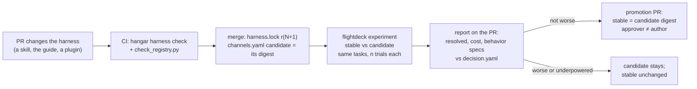

# Team harness (example)

A **team harness** is everything that shapes how your team's coding agent behaves, kept in git and pinned by digest:
the instructions it reads, its skills, its hooks, its plugins and which MCP servers it may call. This repository is a
complete, copyable example built around a typical stack: **OpenSpec**, **GitHub** (PRs and Projects), **Jira**,
**Splunk** and **GKE**. It is used with [hangar](https://github.com/Sean-Koval/hangar) (runs agents from it),
[flightdeck](https://github.com/Sean-Koval/flightdeck) (judges changes to it) and
[ai-dlc](https://github.com/Sean-Koval/ai-dlc) (authors the workflow plugin it pins).

> This example lives in [agent-factory](https://github.com/Sean-Koval/agent-factory) under `examples/team-harness/`
> until it has its own repository. Point `HANGAR_HARNESS_REPO` at a standalone copy: hangar looks up older channel
> revisions in git history relative to the repository root.

Nothing here belongs to a real organisation: endpoints are public vendor URLs or `example.com`, and credentials
appear by name only.

## What it looks like

```text
harnesses/team-default/
  CLAUDE.md                          the team's instructions (AGENTS.md is the same bytes, for Codex)
  skills/
    openspec-change/SKILL.md         propose, validate, implement and archive one OpenSpec change
    github-pr/SKILL.md               branch, PR body, checks, and the Projects Status field
    jira-ticket/SKILL.md             pick up "Ready for agent", comment, link, transition
    splunk-logs/SKILL.md             bounded, read-only log searches through the splunk MCP server
    gke-diagnose/SKILL.md            read-only cluster diagnosis through the gke MCP server
  native/claude-code/
    settings.json                    hooks + deny rules, written to ~/.claude/settings.json
    hooks/guard_readonly.py          PreToolUse: blocks mutating kubectl/helm/gcloud and credential dumps
  native/codex/ai-dlc-workflow/      the plugin's Codex form (same skills, hooks, AGENTS fragment), native components
  plugins/team-harness/              a Claude Code directory marketplace (hangar#221 layout)
    .claude-plugin/marketplace.json  lists exactly the lock's plugins of this marketplace
    ai-dlc-workflow/                 the ai-dlc workflow plugin, pinned as one component
  harness.lock                       pins all of the above, plus the CLI version, model and MCP bindings
  env.stable.yaml                    hangar environments that provide these files (generated)
  env.candidate.yaml
channels.yaml                        team-default: {stable: sha256:…, candidate: sha256:…}
```

The lock is hangar's `hangar.harness-lock/v1`. One component per file or directory, and a binding layer that holds
names, never values:

```yaml
schema: hangar.harness-lock/v1
name: team-default
revision: 2
runtime: {harness: claude-code, version: 2.1.296}
model: {id: claude-opus-5-5, policy: balanced}
components:
- {id: guide:CLAUDE.md, digest: sha256:2ac8…, path: CLAUDE.md}
- {id: skill:github-pr, digest: sha256:4991…, tree: sha256:7205…, path: skills/github-pr}
# … four more skills, then the plugin and the native files
- {id: plugin:ai-dlc-workflow@team-harness, digest: sha256:…, path: plugins/ai-dlc-workflow, enabled: true}
binding:
  mcp:
  - {name: github, transport: http, endpoint: "https://api.githubcopilot.com/mcp/", header_names: [Authorization]}
  - {name: gke, transport: stdio, command: kubernetes-mcp-server, args: [--read-only], env_names: [KUBECONFIG]}
  - {name: jira, transport: http, endpoint: "https://mcp.atlassian.com/v1/mcp", header_names: [Authorization]}
  - {name: splunk, transport: http, endpoint: "https://splunk.example.com:8089/services/mcp", header_names: [Authorization]}
  permissions: {approvals: deny-risky}
plugins: {autoUpdate: false}
```

Its identity is one digest, `harness_digest`. A turn hangar runs from this harness reports the same digest in its
manifest; if the sandbox had anything else, the difference is recorded as drift.

```console
$ hangar harness check harnesses/team-default
ok: team-default r4, 24 component(s), harness_digest sha256:…
```

## Run an agent from it

Point the hangar server at a checkout of this repository, then name a channel:

```sh
# hangar server settings
HANGAR_HARNESS_REPO=/srv/team-harness                                   # a checkout (hangar#138 adds fetching)
HANGAR_ENV_DIRS='["envs", "/srv/team-harness/harnesses/team-default"]'  # adds team-default, team-default-candidate

# anyone with a hangar token
hangar harness thaw team-default@stable --env team-default "Pick up ABC-123"
```

`team-default@stable` resolves through `channels.yaml` to a digest, and hangar finds that lock in the checkout or in
its git history. The session is pinned to the lock's CLI version, model and approval mode; the MCP servers must exist
in the environment (endpoints and credentials live there, not here). Until hangar mounts a lock's files itself
(hangar#221), the environment provides them: `env.stable.yaml` carries exactly the pinned files, and
`scripts/check_registry.py` proves with hangar's own manifest code that a turn on it reports the lock's digest.

## From change to promotion



1. **A change becomes a candidate.** Someone edits the harness: here, turning on the ai-dlc workflow plugin. The PR
   updates the files, re-pins them (`hangar harness freeze` from a good run, or `scripts/relock.py` for a hand edit)
   and points `candidate` at the new digest. `stable` doesn't move. Thawing `team-default@stable` still gives
   yesterday's harness, found in git history.
2. **The candidate becomes an experiment.** `flightdeck/suite.yaml` runs the same tasks on both arms
   (`environment: team-default` and `team-default-candidate`, which differ only by the plugin), `n` trials each.
   `flightdeck/decision.yaml` was committed first: promote only if resolved tasks don't drop by more than 5 points.
   The behavior specs in `flightdeck/specs/` judge how each arm worked (tests before commit, a PR delivered, the
   ticket read before editing, the cluster left alone).
3. **The experiment becomes a promotion, or doesn't.** flightdeck posts its report on the PR. If the verdict holds,
   a second person opens a one-line PR setting `stable` to the candidate's digest. If not, or if the evidence is
   underpowered, `stable` stays where it was, and the report says so.

This repository's history shows the first round: commit one is `r1` (no plugin, `stable`), commit two adds the
plugin as `r2` (`candidate`), `r3` refreshes it from ai-dlc main with its Codex form, and `r4` moves it into hangar#221's
marketplace layout (`candidate`).

## The ai-dlc workflow plugin

`plugins/team-harness/ai-dlc-workflow/` is ai-dlc's workflow guidance, team skills and safety hooks packaged as one Claude Code
plugin ([ai-dlc#191](https://github.com/Sean-Koval/ai-dlc/issues/191),
[#193](https://github.com/Sean-Koval/ai-dlc/issues/193)). It is the A/B's only difference:

| Channel | Lock | Plugin |
| --- | --- | --- |
| `stable` | r1 | not a component (off) |
| `candidate` | r4 | `plugin:ai-dlc-workflow@team-harness`, `enabled: true` (on), plus its Codex form as `native:codex/ai-dlc-workflow/*` |

Both paths are generated by ai-dlc's `scripts/build_workflow_plugin.py` (digests in the plugin's `plugin.lock.json`,
source commit in the lock component's `source`) and refreshed by PR with ai-dlc's
`scripts/publish_workflow_plugin.py --harness-repo harnesses/team-default --marketplace team-harness --apply`, which refuses to overwrite hand
edits, followed by `scripts/relock.py` and a `candidate` move. Don't edit them by hand. The plugin keeps
`defaultEnabled: false` and the lock keeps `plugins: {autoUpdate: false}`.

The Codex form under `native/codex/ai-dlc-workflow/` is pinned so a Codex arm can carry the same treatment. It works as
a Codex local plugin (`.codex-plugin/plugin.json`) or, as mapped here, under `~/.codex/ai-dlc-workflow/` with its
`hooks.json` merged into `~/.codex/hooks.json`. This harness's runtime is Claude Code, so `render_envs.py` does not put
it in the environments yet, and Codex runs its hooks only after they are trusted (ai-dlc's plugin README records the
Codex 0.162.1 spike).

What works today and what waits on hangar:

- **Pinned, checked and thawed.** hangar's lock pins `plugin:` components at `plugins/<marketplace>/<source>` with the
  manifest's plugin digest, `hangar harness check` recomputes it in CI, and `hangar harness thaw team-default@candidate
  --env team-default` mounts the lock's plugins itself ([hangar#221](https://github.com/Sean-Koval/hangar/issues/221)).
  `scripts/check_registry.py` runs that claim when this directory is a repository root.
- **`env.candidate.yaml` stays for experiments.** flightdeck's variants still name an environment until hangar runs
  experiment variants by lock ([hangar#135](https://github.com/Sean-Koval/hangar/issues/135)), so the candidate arm
  keeps an environment that loads the plugin from hangar's read-only seed; `check_registry.py` proves it reproduces the
  candidate lock's `harness_digest`. Drop it once variants are `{harness_lock: team-default@candidate}`.
- **`stable` was re-keyed, not moved.** hangar#221 changed the manifest's plugin identity and with it the
  `harness_digest` form; `stable` still names r1, at its new digest.

## Copy it for your team

1. Copy this directory into a new repository. Commit `harness.lock` before you change it, so `stable` resolves.
2. Replace the Splunk endpoint (`splunk.example.com`) with yours, adjust the skills to your workflow and the Projects
   field names in `github-pr`, and set the credential names in `bindings/team-default.yaml`.
3. Re-pin and regenerate:

   ```sh
   pip install "hangar @ git+https://github.com/Sean-Koval/hangar@266280580d0cb541e34b67253def686633f74038"
   python scripts/relock.py harnesses/team-default --write
   python scripts/render_envs.py harnesses/team-default
   hangar harness check harnesses/team-default && python scripts/check_registry.py
   ```

4. Point `stable` at the new digest (the first time only; after that, only promotion moves it), and ask your hangar
   admin for the four credentials named in `bindings/team-default.yaml`.
5. Freeze the real thing: once a turn goes well, `hangar harness freeze <job> --out harnesses/team-default` replaces
   the hand-written pins with an observed run.

## Layout

| Path | What it is |
| --- | --- |
| `harnesses/<name>/` | One harness: native files plus `harness.lock` |
| `channels.yaml` | Channel → `harness_digest`, per harness |
| `bindings/<name>.yaml` | Where each MCP credential comes from (credential names, `${VAR}` references), for the environments |
| `flightdeck/` | The A/B suite, its pre-registered decision and the behavior specs |
| `scripts/relock.py` | Re-pin a hand-edited harness with hangar's digest code |
| `scripts/render_envs.py` | Generate the hangar environments that provide a harness's files |
| `scripts/check_registry.py` | CI beyond `hangar harness check`: guides in sync, envs current and reproducing the lock, channels resolving and passing hangar's claim checks |
| `.github/workflows/check.yml` | The CI for a standalone copy |

## CI

Every PR runs `hangar harness check` on each harness (hangar installed from git at a pinned commit),
`scripts/check_registry.py`, and `flightdeck spec lint` on the behavior specs. Check out with full history
(`fetch-depth: 0`): channels resolve through it.
