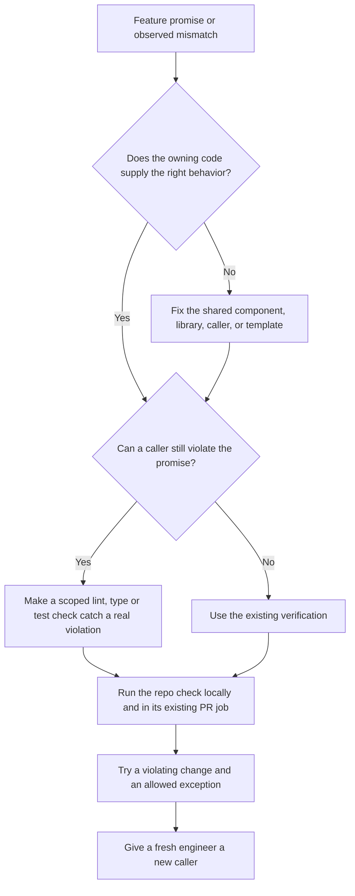

# Where to put a team standard

Use this when a feature, design decision, review, or repeated correction should shape what the next engineer builds. Name one observable promise and a legitimate exception. Find the production entry point and an existing caller that already does it correctly.

When the promise or exception is undecided, ask the person who owns it. Use the existing architecture, SRE or database approval at its defined point. Record which environment or release a signed exception covers.

| What you find | The smallest useful change | Example |
| --- | --- | --- |
| Each caller has to remember a behavior | Put it in the shared API and adopt it in the affected callers. | A shared dialog restores keyboard focus on Cancel. One workflow supplies a different return target. |
| The supported API is sound and feature code bypasses it | Restrict the obsolete import in the affected paths. Name the supported replacement in the lint message. | Feature packages use the design-system button. Its own implementation still imports the primitive. |
| The behavior exists but a meaningful regression stays green | Add a behavioral assertion at the appropriate boundary. | Exercise an MCP tool over stdio and compare its published response. A draft tool may change its text. |
| The local check fails correctly but the PR skips it | Inspect the trigger, path filter, job command and required status. | A schema-only change must schedule the existing contract check. |
| Fresh projects inherit a bad example | Fix the generating template and regenerate a clean project. Check existing consumers separately. | Updating an agent template fixes future repos. An existing installation may still pin an old library. |
| Fresh sessions repeatedly overlook the supported path | Check the installed digest and startup guide, then tune the shared intake cue or a repo-local pointer. | An agent can find the component when prompted yet miss it on an ordinary feature ticket. |
| Acceptance depends on taste or an exception owner | Link the decision and owner in the ticket. | A design owner can approve a focus destination. An automated test can verify that a keyboard user reaches it. |

## Use it in a ticket

1. In Jira, state the promise, its scope and any known exception. Work Copilot can locate earlier decisions and their source links.
2. With Team Harness, ask the agent to inspect the real caller and apply an authorized change in the current repo. Ask for advice explicitly when a decision is still pending. In other agents, supply the [skill](../shared/work-system/skills/implement-standard/SKILL.md) when the runtime has no project-skill discovery.
3. In the PR, show the ordinary verification command, the observed failure on a deliberate violation, and the permitted case passing. Link the real run when checking hosted CI. AI-DLC can use that evidence in the existing delivery flow.
4. Hand a second engineer a normal new-caller ticket. Check whether they inherit the rule without a reminder. Keep one worked example and links in Confluence. Change the code, check, workflow or harness cue where the evidence shows the gap.

To rehearse without touching production, the [field panel](../evals/implement-standard/field54/README.md) prepares 54 isolated tickets and checks completed edits. The [worked UI example](../shared/work-system/skills/implement-standard/examples/dialog/README.md) includes local lint and browser verification.
