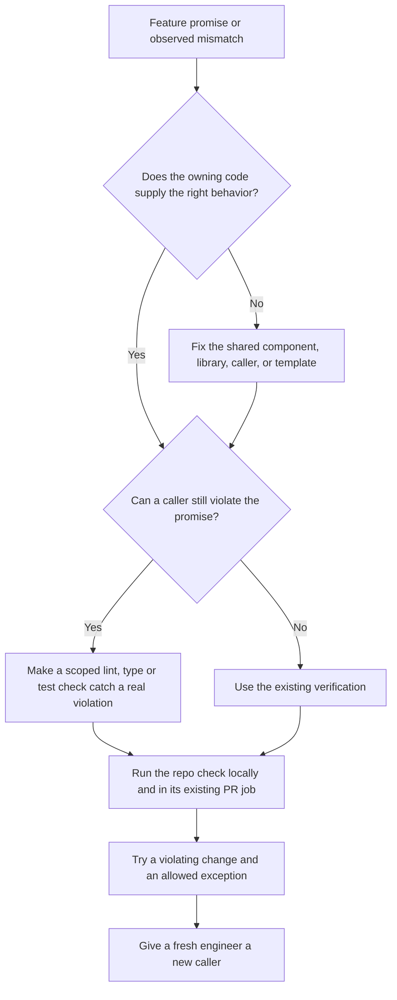

# Where to put a team standard

Use this when a feature, design decision, review, or repeated correction should shape what the next engineer builds. Name one observable promise and a legitimate exception. Find the production entry point and an existing caller that already does it correctly.



When the promise or exception is undecided, ask the person who owns it. Use the existing architecture, SRE or database approval at its defined point. Record which environment or release a signed exception covers.

| What you find | The smallest useful change | Example |
| --- | --- | --- |
| Each caller has to remember a behavior | Put it in the shared API and adopt it in the affected callers. | A shared dialog restores keyboard focus on Cancel. One workflow supplies a different return target. |
| The supported API is sound and feature code bypasses it | Restrict the obsolete import in the affected paths. Name the supported replacement in the lint message. | Feature packages use the design-system button. Its own implementation still imports the primitive. |
| The behavior exists but a meaningful regression stays green | Add a behavioral assertion at the appropriate boundary. | Exercise an MCP tool over stdio and compare its published response. A draft tool may change its text. |
| The local check fails correctly but the PR skips it | Inspect the trigger, path filter, job command and required status. | A schema-only change must schedule the existing contract check. |
| Fresh projects inherit a bad example | Fix the generating template and regenerate a clean project. Check existing consumers separately. | Updating an agent template fixes future repos. An existing installation may still pin an old library. |
| Fresh sessions repeatedly overlook the supported path | Check the installed digest and startup guide, then tune the shared intake cue or a repo-local pointer. | An agent can find the component when prompted yet miss it on an ordinary feature ticket. |
| Acceptance depends on taste or an exception owner | Link the decision and owner in the ticket. | A design owner can approve a focus destination. An automated test can verify that a keyboard user reaches it. |

## Use it in a ticket

1. In Jira, state the promise, its scope and any known exception. Work Copilot can locate earlier decisions and their source links.
2. With Team Harness, ask the agent to inspect the real caller and apply an authorized change in the current repo. Ask for advice explicitly when a decision is still pending. In other agents, supply the [skill](../shared/work-system/skills/implement-standard/SKILL.md) when the runtime has no project-skill discovery.
3. In the PR, show the ordinary verification command, the observed failure on a deliberate violation, and the permitted case passing. Link the real run when checking hosted CI. AI-DLC can use that evidence in the existing delivery flow.
4. Hand a second engineer a normal new-caller ticket. Check whether they inherit the rule without a reminder. Keep one worked example and links in Confluence. Change the code, check, workflow or harness cue where the evidence shows the gap.

## Give the agent the rule when work starts

During Jira intake, add `standards-change` in the **Labels** field when a ticket establishes, applies or evaluates a team promise. A single caller, a review, or an existing regression test can qualify. For example, “Does Cancel return focus to the right place if the trigger disappears?” qualifies. “Rename the Cancel button in this screenshot” can proceed normally. An engineer who uncovers a shared rule on an existing unmarked ticket can open `implement-standard` immediately. Keep the existing execution label and approvals.

| Where the engineer starts | How the rule gets to the agent | How to check it |
| --- | --- | --- |
| Work-default in interactive Claude Code | Read the issue using the configured tracker’s single-issue get tool before an edit. On a marked issue the installed hook supplies the skill before Claude’s **next** action. | Inspect the post-read context for the issue key, SHA-256 and full text. If the install is damaged, repair it before the affected edit. |
| A stdin-capable coding agent, including personal use | Use the installed launcher as the normal ticket entry point. It reads the structured issue, then starts the agent with the skill in its first prompt when marked. | Match the SHA-256 in the initial prompt to the configured skill. An incomplete label response exits before starting the agent. |
| An operator-managed Hangar Jira project | Enable the optional `standards_intake` project setting from the same installed skill. The existing Jira trigger and authorization checks still determine whether the job starts. | On a marked job, inspect `intake.skill` and `intake.skill_sha256` in the job metadata and compare with the first agent prompt. |

**Set up one repo first.** Install a work-default revision containing this change using the [project installer](../README.md#run-it-on-a-laptop), then run the installer with `--check`. Use the installed scripts in that project. A user-scope install uses the same relative path under your home directory. For another agent or a personal repo, the [portable skill directory](../shared/work-system/skills/implement-standard) contains the same launcher and needs only Python. Keep personal and company installs, tickets and project records in their own environments.

For a CLI, save the result of the authorized Jira single-issue REST read (`GET /rest/api/3/issue/WEB-24?fields=labels`) as `issue.json` or pipe the JSON on stdin using `-` in place of the filename. The agent reads the ticket itself through the usual project intake. Set the command to the agent you already use.

```sh
python .claude/skills/implement-standard/scripts/intake.py run issue.json -- codex exec -
python .claude/skills/implement-standard/scripts/intake.py run issue.json -- claude -p
```

For hosted jobs, run the following command in the approved installation. Put the JSON object it prints into **one project’s** `HANGAR_JIRA.projects.<PROJECT>.standards_intake` on a host supporting this setting. Preserve the rest of the operator-managed config. Re-export when adopting a different rule revision and test a marked and an ordinary ticket after deployment.

```sh
python .claude/skills/implement-standard/scripts/intake.py hangar-config
```

## Close the loop in records the team already reads

| Record | Example for keyboard Cancel |
| --- | --- |
| Jira ticket or linked repo spec | “Cancel preserves the draft and returns focus to its opener. When deletion removes the opener, focus moves to Saved drafts.” Link the component, callers and the agreed design. |
| ADR or Jira Decision | If the right fallback is undecided, link the question and design owner. Continue independent work. Retain any SRE, architecture or database approval and its exact scope. |
| Pull request | Name the shared component and ordinary check. Show the change that leaves the draft visible fails, the legitimate deletion fallback passes, and link the hosted job for the same revision. |
| Project state | Update the ticket with verified criteria, pending checks, and the owner of the next action. Update the existing epic Roadmap when a milestone or dependency changes. A green local test establishes local evidence. |

With four engineers, give one pair the [dialog example](../shared/work-system/skills/implement-standard/examples/dialog/README.md) and the other a published MCP response. Each reviewer introduces a plausible violation in a scratch copy and tries a supported exception. Swap pairs and give each successor an ordinary new caller. Record where the behavior first broke: component, validator, CI invocation, or failure to use the existing path.

For a pilot, report **filing recall** (relevant tickets marked / relevant tickets independently identified), **timely delivery** (marked tickets receiving the full body before the affected edit / marked tickets), and **verified action** (authorized builds with a real change and passing ordinary check / authorized builds). Count unnecessary activations on ordinary work. Include unmarked tickets and advice-only requests in the sample. A full skill in a trace establishes delivery; the diff, failing violation and passing exception establish what the engineer implemented. The [64-ticket field panel](../evals/implement-standard/field/README.md) provides repeatable sandbox cases.
